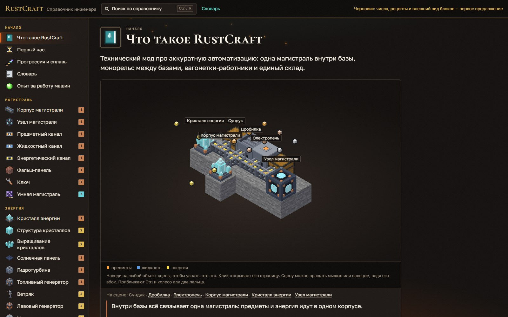
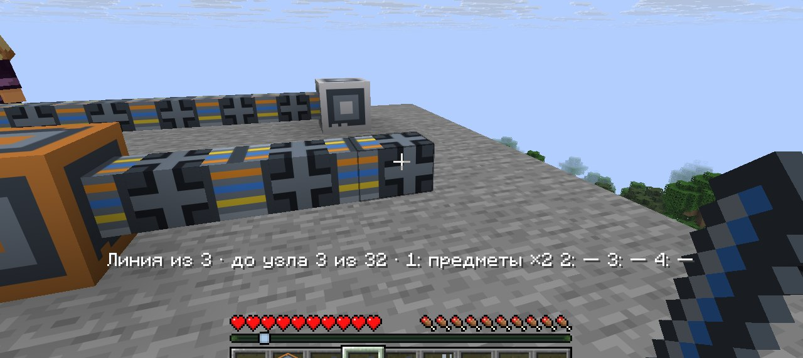
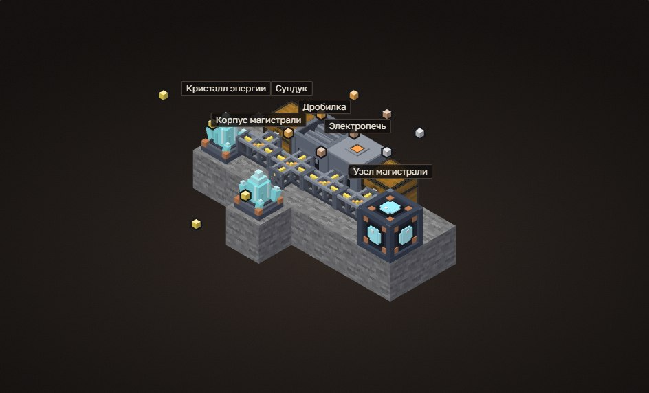
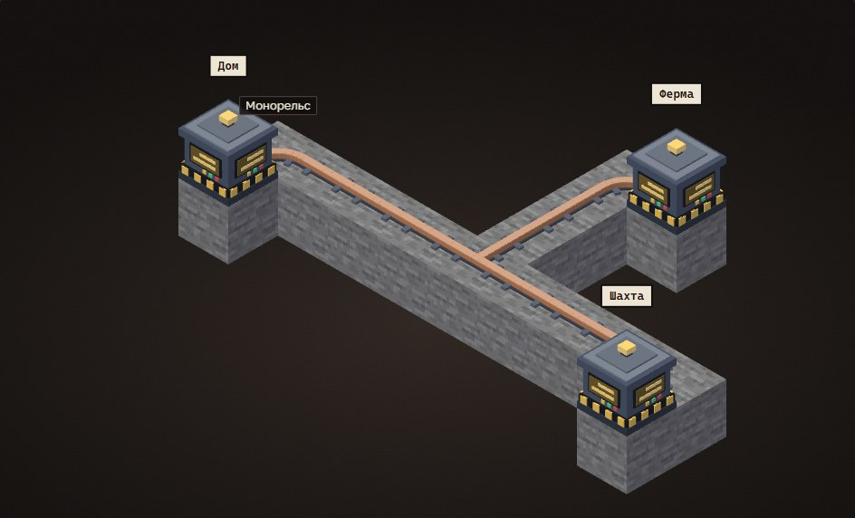
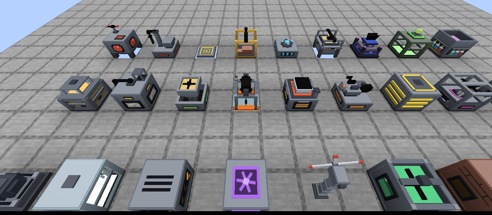
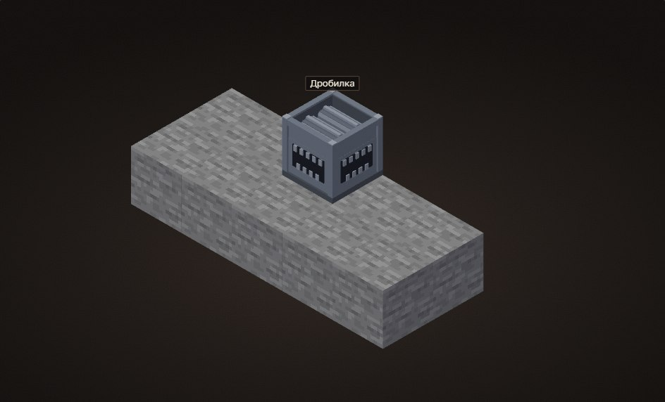
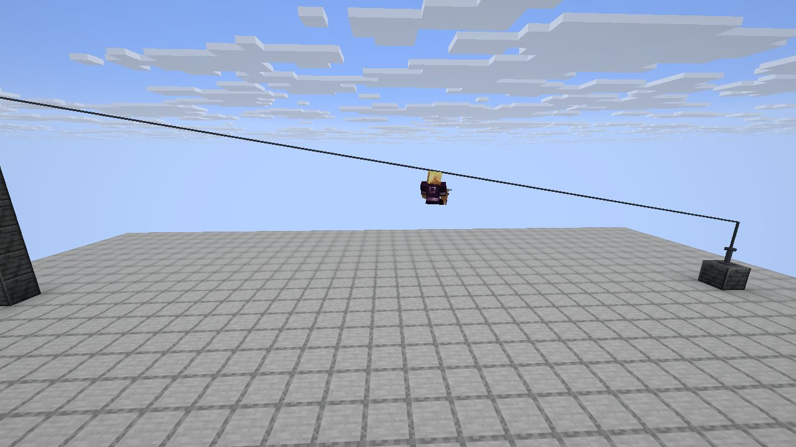
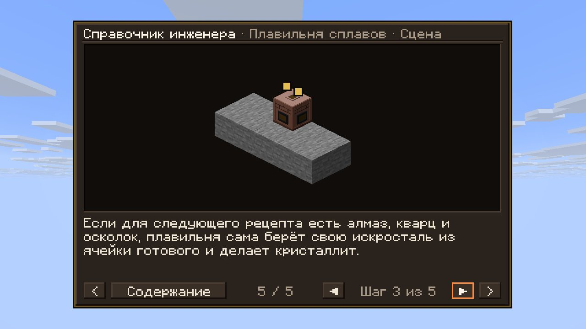

<div align="center">

[Русский](README.md) · **English**

# RustCraft

**A tech mod for Minecraft on [Horizon](https://github.com/horizon-rust/horizon): one magistral for the whole base, machines, storage, a monorail, workers and turrets.**<br>
Items, energy and fluids travel in a single housing, and machines take their input from it and hand back the result on their own.

[](https://github.com/Betreazen/rustcraft/releases/latest)


[](LICENSE)

[Features](#features) · [Engineer's reference](https://betreazen.github.io/rustcraft/showcase/) · [Install](#install) · [Changelog](CHANGELOG.md) · [Design spec](docs/design/02-spec.md)



</div>

## What it is

RustCraft is a mod about tidy automation. Inside a base everything is joined by the **magistral**: a slim housing with four sockets for item, energy and fluid channels. You don't wrap a machine in pipes. It stands against the housing and takes what it needs. A **monorail** with a capsule runs between bases, **workers** ride the rails, and a single **storage** with a terminal replaces your chests.

The mod is written entirely in Rust as a native Horizon mod and runs on the same server as [Path-of-craft-tree](https://github.com/Betreazen/path-of-craft-tree) and [SoulsCraft](https://github.com/Betreazen/soulscraft).

<p align="center"><br><sub>The mod in the game: the magistral, machines and farm blocks with the guide's models</sub></p>

> [!NOTE]
> Version 0.18: the game matches the guide — every block, window, mechanic and piece of gear works as the guide says; the remaining differences are listed in [mod/README.md](mod/README.md). Everything listed below is covered by the in-world self-test. Balance numbers are a first proposal and will change after playtests. The in-game texts and the design docs are Russian first. The game's blocks, windows and diagnoses also have English names.

## Features

- **Magistral.** The housing connects to neighbouring housings and nodes by itself. A node carries a line up to 32 blocks, and channels come in three tiers of throughput. The wrench removes channels and opens the joint window: a direction for every face, and a filter and priority for items.
- **Energy.** Crystal, solar panel, windmill, hydro turbine, fuel and lava generators, batteries with modules. Crystal structures grow on a nutrient solution.
- **Machines.** Electric furnace, crusher (two dusts per ore), alloy smelter, autocrafter with recipe pages, mixer, miner, block placer and breaker, and a butcher for animal farms. Modules go into machine sockets.
- **Catalysts.** The mixer makes an accelerator, an economizer and an enricher: the furnace and crusher run faster, use less energy, or sometimes give an extra product.
- **Fluids.** Tanks, a pump and the fluid channel.
- **Storage.** Cells add up to one storage. The terminal searches, filters by tabs and keeps limits. With the recipe book the storage fills orders itself: it spreads the crafting chain over free machines, the mixer included, keeps N items in stock, and the queue survives a server restart. The tablet shows the storage and hands out stacks from a distance.
- **Monorail.** Rail on floors, walls and ceilings, named stations with a network map, a capsule at 32 blocks per second, a lift.
- **Workers.** A chassis on the rails with tools: saw, reaper, cargo hold, grab, scoop, the shooter that turns a worker into a guard, and the tunneler bore that digs its own tunnel and lays its own rails. Unload, load and charge docks.
- **Defence.** Turrets with bleeding, poison and slowness modules, and support turrets: healing, protection, strength, speed. The base anchor keeps chunks loaded.
- **Farming and crafts.** Kitchen, fishing station, feeder, shearer-milker, apiary collector, brewing vat, experience condenser, enchanting machine, archaeology table, repair stand.
- **Trash and disintegrator.** Surplus burns by filter; unwanted items come apart into half their ingredients.
- **Holo-projector and building machine.** The projector remembers a building and shows its ghost; the machine builds it from its slots.
- **Portal dock** sends cargo to another world; the **facade** hides the magistral under any block.
- **Living blocks.** Rolls, drills, rotors, flames and lamps move as in the guide; tanks show their fluid, batteries their charge.
- **Gear.** Technical armour in three tiers with player modules (night vision, jump, run, dash, magnet, damper, shock absorber) and a jetpack, the energy blade, shield and rifle, the zipline with ropes that stay in the world and can be ridden again, the harpoon that also hooks mobs, technical enchantment books. All run on batteries charged at the charger and the charge plate.
- The **living vein** grows ore, a chosen ore or suspicious sand for archaeology, the **cartographer** finds new biomes and the world's structures along its way, the **scout compass** leads to them.
- **The engineer's handbook in the game.** The first alloy brings the book: a page for every block and item of the mod with its description, recipe, window parts and the guide's animated scene.
- **Backpacks** with 27 and 54 slots.
- **Experience for machine work.** Machines tell Path-of-craft-tree what they did, and their owner earns profession experience in the skill tree. Turret and guard kills count in SoulsCraft's hunter's book.
- **Two languages.** Names, windows and diagnoses in Russian and English.

<table>
<tr>
<td width="50%"></td>
<td width="50%"></td>
</tr>
<tr>
<td align="center"><b>Magistral</b>: machines take input straight from the housing</td>
<td align="center"><b>Monorail</b>: named stations, the capsule drives itself</td>
</tr>
<tr>
<td width="50%"></td>
<td width="50%"></td>
</tr>
<tr>
<td align="center"><b>In game</b>: farm and workshop blocks</td>
<td align="center"><b>Crusher</b>: two dusts from one ore</td>
</tr>
<tr>
<td width="50%"></td>
<td width="50%"></td>
</tr>
<tr>
<td align="center"><b>Zipline</b>: the rope stays in the world and is ridden again</td>
<td align="center"><b>Handbook in the game</b>: a page for every block, its recipe and scene</td>
</tr>
</table>

## Engineer's reference

The [reference](https://betreazen.github.io/rustcraft/showcase/) has a page for every block, item and module: a 3D scene you can rotate, the block's window, its recipe, stats and every diagnosis. Blocks in the game follow its models. It also opens locally: double-click `docs/showcase/index.html`, no server needed. The reference is in Russian.

It describes the whole planned mod. What is already in the game is listed [above](#features), and slice by slice in [mod/README.md](mod/README.md).

## Install

You need the [Horizon launcher](https://github.com/horizon-rust/horizon) and a licensed Minecraft: Java Edition account.

> [!WARNING]
> Horizon native mods are compiled into the game and run with your rights, unsandboxed. Read the code before installing. The launcher asks you to confirm that you trust the mod. See [SECURITY.md](SECURITY.md).

The mod has two parts with the same id `rustcraft`:

| Folder | What it is |
| --- | --- |
| `mod/rustcraft/` | the native bundle: code of the blocks, machines and network, compiled into the game and the server |
| `mod/content/` | the content mod: models, textures, names, recipes and loot |

Both parts are needed in the game and on the server, at the same version. Without the content mod the blocks work but show their template look.

### Client

```powershell
git clone --branch v0.19.2 https://github.com/Betreazen/rustcraft
horizon-launcher native-build rustcraft/mod/rustcraft --instance <instance> --trust-native-code
```

Then copy the contents of `mod/content` into the instance's `horizon-mods/rustcraft` folder (beside `options.txt`) and turn the mod on with the line `mod.rustcraft:true` in `horizon-mods.txt` in the same folder. The first build downloads Rust and takes 20–30 minutes; later builds are faster.

### Dedicated server

```powershell
horizon-launcher native-build rustcraft/mod/rustcraft `
    --server-output C:\horizon-engines\rustcraft-0.19.2 --trust-native-code
horizon-server --dir <server folder> config set engine.path=C:\horizon-engines\rustcraft-0.12.0\horizon-engine.exe
```

The content mod goes into the server folder's `horizon-mods/rustcraft` and is turned on the same way. The `--server-output` folder must not exist yet. To build a server with several mods, put their bundles side by side and pass `native-build` the common folder. See [Horizon's native mod docs](https://github.com/horizon-rust/horizon/blob/main/docs/native-mods.md).

The mod is pinned to Horizon commit `7e4e421` (`[compatibility] horizon_revision` in `mod/rustcraft/horizon-mixin.toml`). If your other native mods are pinned to another commit, the launcher offers **Build anyway**.

## Works with

| Mod | What it adds together with RustCraft |
| --- | --- |
| [Path-of-craft-tree](https://github.com/Betreazen/path-of-craft-tree) | Machines earn their owner profession experience for the same work: the furnace for Smith, the miner for Miner, the butcher for Herdsman. Contract: [docs/design/path-of-craft-tree-contract.md](docs/design/path-of-craft-tree-contract.md) |
| [SoulsCraft](https://github.com/Betreazen/soulscraft) | Turrets apply SoulsCraft's bleeding and help on altar waves; turret and guard kills go into the hunter's book |

The mods are built and tested together on a shared bench, on one Minecraft version (26.3) and one Horizon commit.

## How it is built

| Part | Contents |
| --- | --- |
| `mod/rustcraft/rules/` | the rules crate, free of the engine: magistral, energy, machines, storage, monorail, workers, turrets. Everything testable lives here |
| `mod/rustcraft/*.rs` | the glue to the game: blocks, hooks, the server tick, windows. It only passes events to the rules |
| `mod/rustcraft/rules/src/selftest/` | the in-world self-test: over a hundred scenarios the server runs without a client |
| `mod/content/` | models, textures, languages, recipes, loot, tags |
| `assets/models/` | block models in Blender: build scripts, `.blend`, `.glb` |
| `docs/showcase/` | the engineer's reference |

Each code slice is checked in three steps: the rules crate's tests, the in-world self-test on the shared bench, and bots in the game only for what can't be checked otherwise.

## Documents

The design documents are in Russian.

- [docs/design/02-spec.md](docs/design/02-spec.md): the design spec; section 6.1 is the plan of code slices.
- [docs/design/03-architecture.md](docs/design/03-architecture.md): how the mod is built (rules crate, bundle, content mod).
- [docs/design/01-decisions.md](docs/design/01-decisions.md): the decision log by round.
- [mod/README.md](mod/README.md): what each slice does, how to build, the self-test, known limits.
- [docs/research/](docs/research/): notes on reference mods (IndustrialCraft 2, BuildCraft, Create, Steve's Carts 2) and on Horizon's modding.
- [CHANGELOG.md](CHANGELOG.md): changes by version.

## Contributing

Bug reports, ideas and pull requests are welcome in Russian or English. How to build and check the mod, and the rules the code keeps, are in [CONTRIBUTING.md](CONTRIBUTING.md).

## License

[MIT](LICENSE). Minecraft assets are not in the repository: the reference draws the game's blocks in a similar style, and the script [tools/local-mc-assets](tools/local-mc-assets) can take the real textures from your own game.
