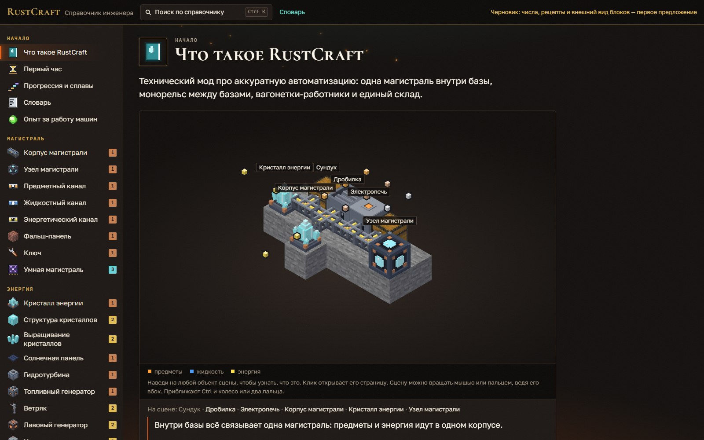
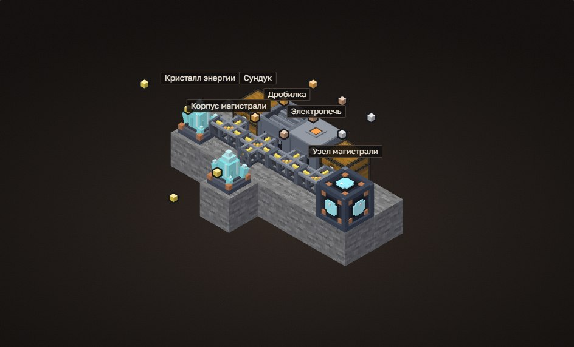
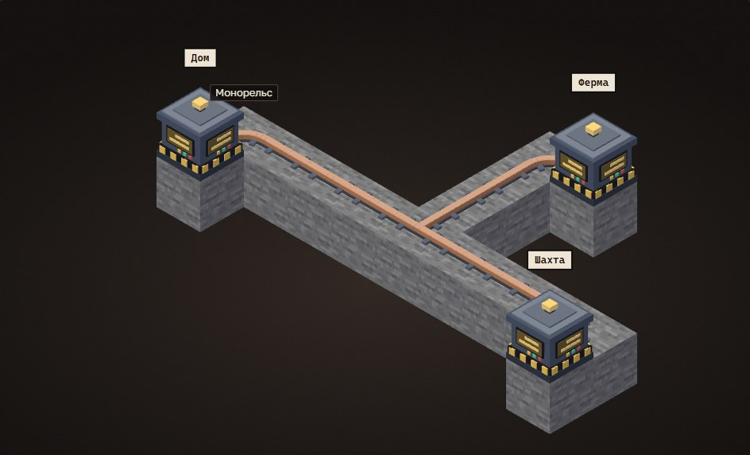
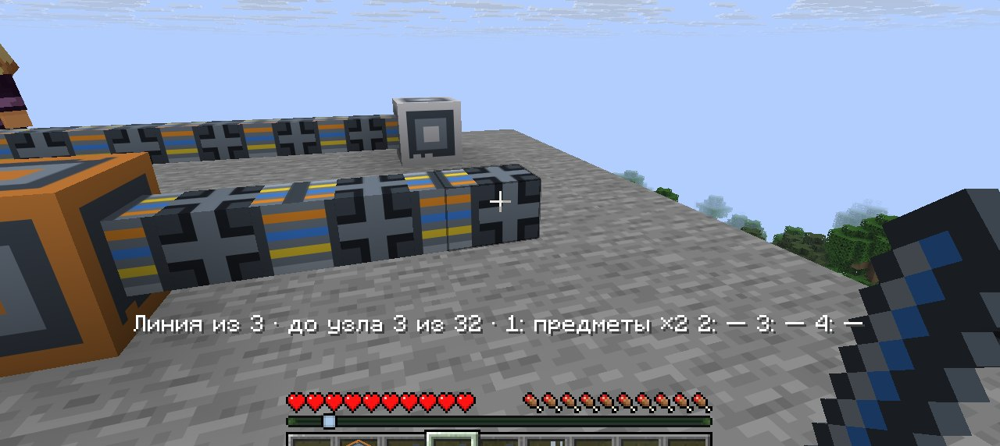
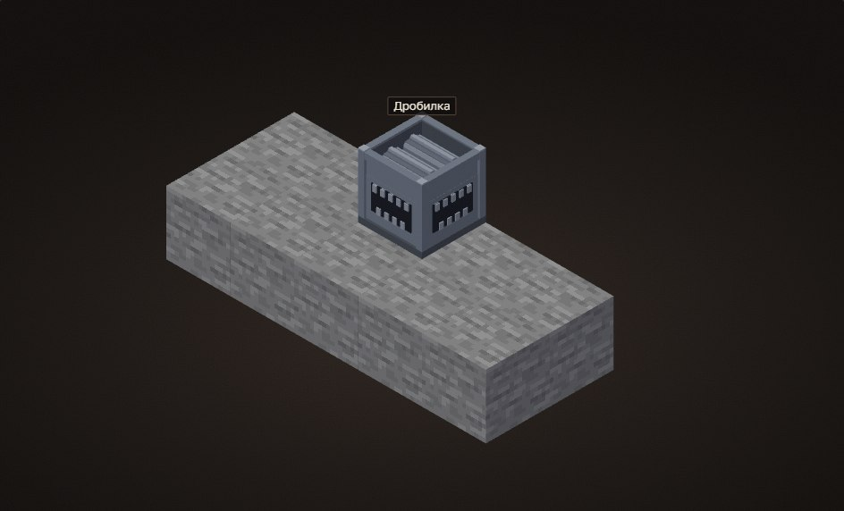

<div align="center">

**Русский** · [English](README.en.md)

# RustCraft

**Технический мод для Minecraft на [Horizon](https://github.com/horizon-rust/horizon): одна магистраль на всю базу, машины, склад, монорельс, работники и турели.**<br>
Предметы, энергия и жидкости идут по одному корпусу, а машины сами берут из него сырьё и отдают готовое.

[](https://github.com/Betreazen/rustcraft/releases/latest)


[](LICENSE)

[Возможности](#возможности) · [Справочник инженера](https://betreazen.github.io/rustcraft/showcase/) · [Установка](#установка) · [Изменения](CHANGELOG.md) · [Спецификация](docs/design/02-spec.md)



</div>

## Что это

RustCraft — мод про аккуратную автоматизацию. Внутри базы всё связывает **магистраль**: тонкий корпус с четырьмя гнёздами под каналы предметов, энергии и жидкостей. Машину не нужно обвешивать трубами: она стоит вплотную к корпусу и сама берёт из него сырьё. Между базами ходит **монорельс** с капсулой, по рельсам ездят **работники**, а сундуки заменяет один **склад** с терминалом.

Мод написан целиком на Rust как нативный мод Horizon и работает на одном сервере с [Path-of-craft-tree](https://github.com/Betreazen/path-of-craft-tree) и [SoulsCraft](https://github.com/Betreazen/soulscraft).

> [!NOTE]
> Мод в активной разработке: версия 0.12, в игре есть все блоки справочника. Всё, что перечислено ниже, работает в игре и проверено самотестом. Числа баланса — первое предложение, они поменяются после плейтестов.

## Возможности

- **Магистраль.** Корпус сам соединяется с соседними корпусами и узлами. Узел держит линию до 32 блоков, каналы трёх ступеней различаются пропускной способностью. Ключ снимает каналы и открывает окно стыка, где для каждой грани задаётся направление, а для предметов ещё фильтр и приоритет.
- **Энергия.** Кристалл, солнечная панель, ветряк, гидротурбина, топливный и лавовый генераторы, накопители с модулями. Структуры кристаллов растут на питательном растворе.
- **Машины.** Электропечь, дробилка (из руды две пыли), плавильня сплавов, автокрафтер со страницами рецептов, смеситель, добытчик, установщик и разрушитель блоков, забойщик для фермы. Модули ставятся в гнёзда машин.
- **Катализаторы.** Ускоритель, экономайзер и обогатитель из смесителя: печь и дробилка работают быстрее, тратят меньше энергии или иногда дают лишний продукт.
- **Жидкости.** Баки, насос и жидкостный канал.
- **Склад.** Ячейки складываются в один склад. Терминал ищет предметы, фильтрует по вкладкам и держит лимиты.
- **Монорельс.** Рельс по полу, стенам и потолку, станции с названиями и схемой сети, капсула на 32 блока в секунду, лифт.
- **Работники.** Шасси на рельсах с инструментами: пила, жатка, грузовой отсек, захват, ковш и стрелок, который превращает работника в стража. Блоки разгрузки, погрузки и зарядки.
- **Оборона.** Турели с модулями кровотечения, яда и замедления и турели поддержки: лечение, защита, сила, быстрота. Якорь базы держит чанки загруженными.
- **Хозяйство.** Кухонный комбайн, рыболовная станция, кормушка, стригаль-доильщик, пасечный сборщик, варочный куб, конденсатор опыта, зачаровательный автомат, археологический стол, ремонтный стенд.
- **Утилизатор и дезинтегратор.** Излишек сгорает по фильтру, ненужные вещи разбираются на половину ингредиентов.
- **Голопроектор и строительный автомат.** Проектор запоминает постройку и показывает её призрак, автомат достраивает её из своих ячеек.
- **Портальный док** передаёт груз в другой мир, **фальш-панель** прячет магистраль под любым блоком.
- **Живые блоки.** Валки, буры, роторы, пламя и лампы двигаются, как в справочнике; бак показывает жидкость, накопитель — заряд.
- **Рюкзаки** на 27 и 54 слота.
- **Опыт за работу машин.** Машины сообщают Path-of-craft-tree, что сделали, и владелец получает опыт профессии в дереве навыков. Убийства турелей и стража засчитываются в книге охотника SoulsCraft.
- **Два языка.** Названия, окна и диагнозы на русском и английском.

<table>
<tr>
<td width="50%"></td>
<td width="50%"></td>
</tr>
<tr>
<td align="center"><b>Магистраль</b>: машины берут сырьё прямо из корпуса</td>
<td align="center"><b>Монорельс</b>: станции с названиями, капсула едет сама</td>
</tr>
<tr>
<td width="50%"></td>
<td width="50%"></td>
</tr>
<tr>
<td align="center"><b>В игре</b>: над хотбаром виден диагноз корпуса</td>
<td align="center"><b>Дробилка</b>: из одной руды две пыли</td>
</tr>
</table>

## Справочник инженера

[Справочник](https://betreazen.github.io/rustcraft/showcase/) — страница на каждый блок, предмет и модуль мода: трёхмерная сцена, которую можно крутить, окно блока, рецепт, характеристики и все диагнозы. Блоки в игре повторяют его модели. Справочник открывается и локально, двойным кликом по `docs/showcase/index.html`, сервер не нужен.

Справочник описывает весь задуманный мод. Что из этого уже есть в игре, перечислено [выше](#возможности), а подробно, по срезам, — в [mod/README.md](mod/README.md).

## Установка

Нужны [лаунчер Horizon](https://github.com/horizon-rust/horizon) и лицензионный аккаунт Minecraft: Java Edition.

> [!WARNING]
> Нативные моды Horizon компилируются прямо в игру и работают с вашими правами, без песочницы. Перед установкой прочитайте код. Лаунчер попросит подтвердить, что вы доверяете моду. Подробнее — в [SECURITY.md](SECURITY.md).

Мод состоит из двух частей с одним id `rustcraft`:

| Папка | Что это |
| --- | --- |
| `mod/rustcraft/` | нативный бандл: код блоков, машин и сети, собирается в игру и в сервер |
| `mod/content/` | контент-мод: модели, текстуры, названия, рецепты и лут |

Обе части нужны и в игре, и на сервере, одной версии. Без контент-мода блоки работают, но выглядят как свои шаблоны.

### Клиент

```powershell
git clone --branch v0.12.0 https://github.com/Betreazen/rustcraft
horizon-launcher native-build rustcraft/mod/rustcraft --instance <экземпляр> --trust-native-code
```

Затем скопируйте содержимое `mod/content` в папку `horizon-mods/rustcraft` экземпляра (рядом с `options.txt`) и включите мод строкой `mod.rustcraft:true` в `horizon-mods.txt` там же. Первая сборка скачивает Rust и занимает 20–30 минут, следующие быстрее.

### Выделенный сервер

```powershell
horizon-launcher native-build rustcraft/mod/rustcraft `
    --server-output C:\horizon-engines\rustcraft-0.12.0 --trust-native-code
horizon-server --dir <папка сервера> config set engine.path=C:\horizon-engines\rustcraft-0.12.0\horizon-engine.exe
```

Контент-мод кладётся в `horizon-mods/rustcraft` папки сервера и включается так же. Папка `--server-output` не должна существовать заранее. Чтобы собрать сервер с несколькими модами, положите их бандлы рядом и передайте `native-build` общую папку. Подробнее — в [документации Horizon о нативных модах](https://github.com/horizon-rust/horizon/blob/main/docs/native-mods.md).

Мод закреплён за коммитом Horizon `7e4e421` (`[compatibility] horizon_revision` в `mod/rustcraft/horizon-mixin.toml`). Если другие ваши нативные моды закреплены на другом коммите, лаунчер предложит **Build anyway**.

## Совместимость

| Мод | Что даёт вместе с RustCraft |
| --- | --- |
| [Path-of-craft-tree](https://github.com/Betreazen/path-of-craft-tree) | Машины приносят владельцу опыт профессии за ту же работу: печь — Кузнецу, добытчик — Шахтёру, забойщик — Скотоводу. Контракт — [docs/design/path-of-craft-tree-contract.md](docs/design/path-of-craft-tree-contract.md) |
| [SoulsCraft](https://github.com/Betreazen/soulscraft) | Турели накладывают кровотечение SoulsCraft и помогают на волнах алтаря; убийства турелей и стража идут в книгу охотника |

Моды собираются и проверяются вместе на общем стенде, на одной версии Minecraft (26.3) и одном коммите Horizon.

## Как устроен

| Часть | Что внутри |
| --- | --- |
| `mod/rustcraft/rules/` | крейт правил без движка: магистраль, энергия, машины, склад, монорельс, работники, турели. Всё, что можно проверить тестом, живёт здесь |
| `mod/rustcraft/*.rs` | связка с игрой: блоки, хуки, тик сервера, окна. Она только передаёт события в правила |
| `mod/rustcraft/rules/src/selftest/` | самотест в мире: больше сотни сценариев, которые сервер прогоняет без клиента |
| `mod/content/` | модели, текстуры, языки, рецепты, лут, теги |
| `assets/models/` | модели блоков в Blender: скрипты сборки, `.blend`, `.glb` |
| `docs/showcase/` | справочник инженера |

Каждый срез кода проверяется в три шага: тесты крейта правил, самотест в мире на общем стенде и, только для того, что иначе не проверить, боты в игре.

## Документы

- [docs/design/02-spec.md](docs/design/02-spec.md) — спецификация дизайна; раздел 6.1 — план срезов кода.
- [docs/design/03-architecture.md](docs/design/03-architecture.md) — устройство мода: крейт правил, бандл, контент-мод.
- [docs/design/01-decisions.md](docs/design/01-decisions.md) — журнал решений по раундам.
- [mod/README.md](mod/README.md) — что делает каждый срез, как собрать, самотест, известные ограничения.
- [docs/showcase/README.md](docs/showcase/README.md) — как устроен справочник.
- [docs/research/](docs/research/) — разбор модов-референсов (IndustrialCraft 2, BuildCraft, Create, Steve's Carts 2) и возможностей Horizon.
- [CHANGELOG.md](CHANGELOG.md) — изменения по версиям.

## Участие

Сообщения об ошибках, идеи и пулл-реквесты принимаются на русском и на английском. Как собрать и проверить мод и каких правил держится код — в [CONTRIBUTING.md](CONTRIBUTING.md).

## Лицензия

[MIT](LICENSE). Ассеты Minecraft в репозиторий не входят: справочник рисует блоки игры в похожем стиле, а настоящие текстуры может взять из вашей игры скрипт [tools/local-mc-assets](tools/local-mc-assets).
